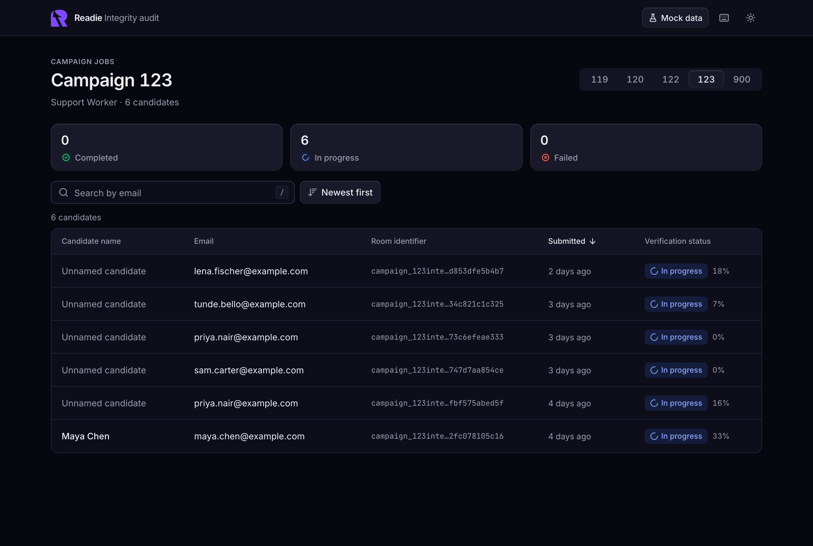
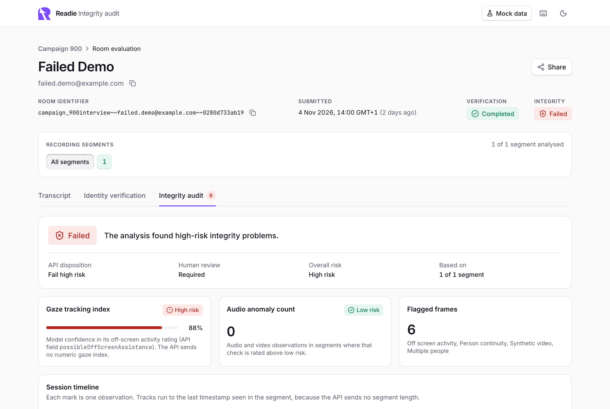
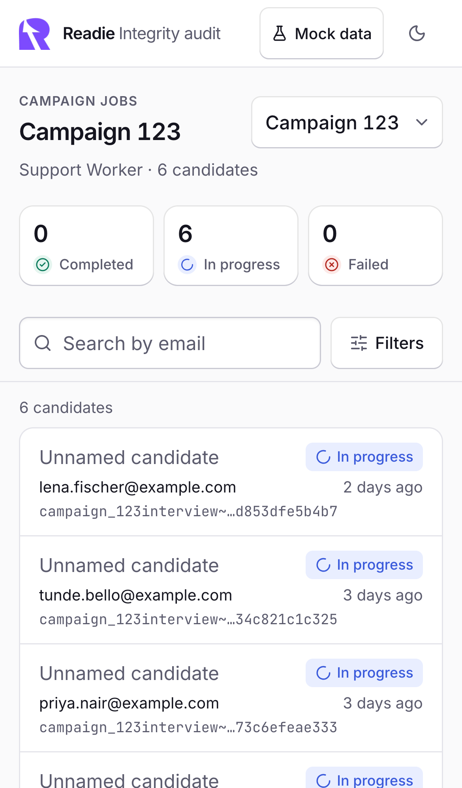
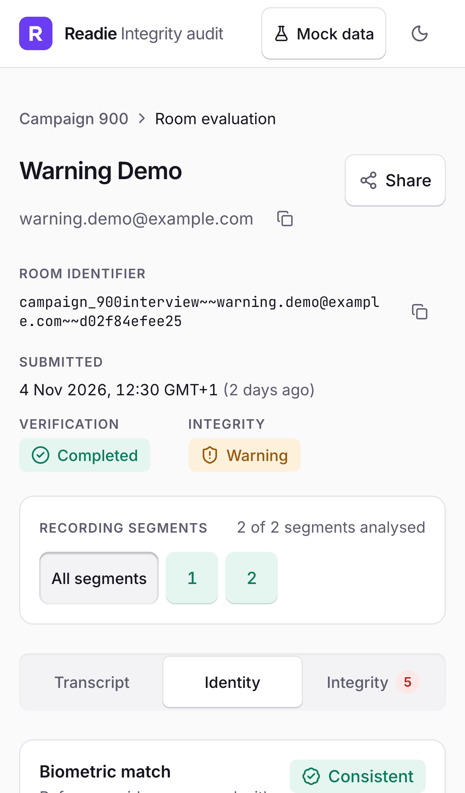
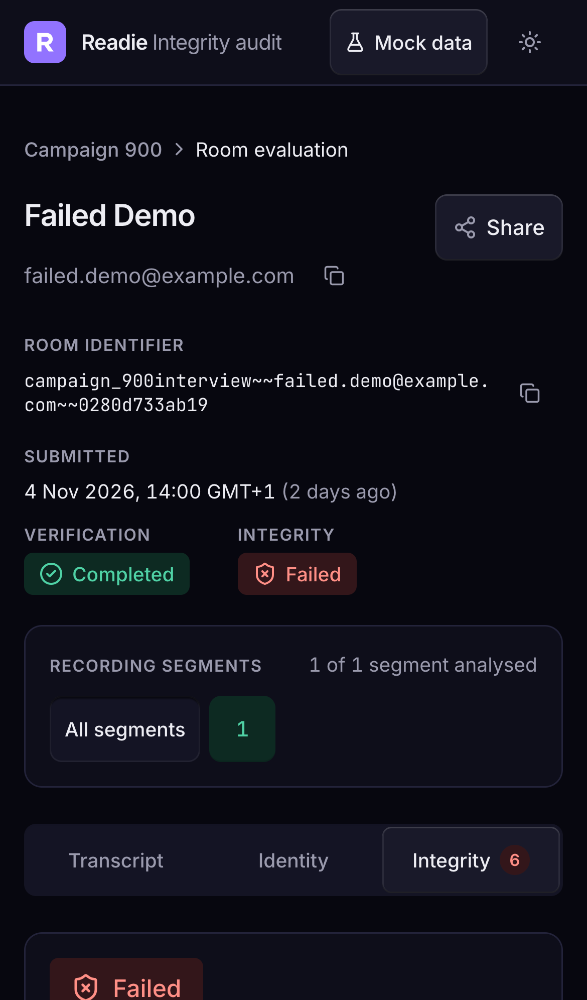
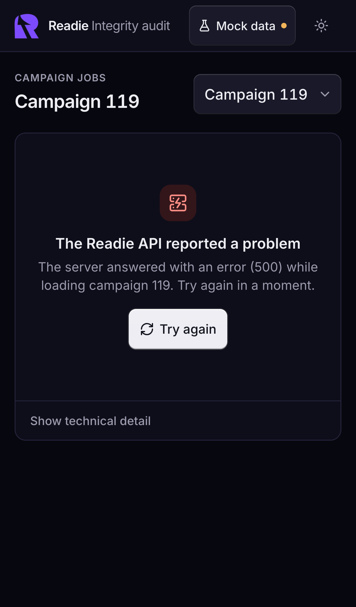

# Readie Candidate Integrity & Audit Portal

A React and TypeScript portal for auditors to review candidate interview sessions: a campaign's candidates, then one room's transcript, identity verification and integrity audit, with every view addressable by URL.

Built for the Readie hackathon brief (`docs/readie-hackathon-spec.pdf`, not committed).

| Campaign overview | Integrity audit |
|---|---|
|  |  |

| Campaign (mobile) | Identity (mobile) | Integrity (mobile, dark) | Error state (mobile, dark) |
|---|---|---|---|
|  |  |  |  |

More in [`docs/screenshots/`](docs/screenshots).

**Live demo:** https://readie-audit-portal.vercel.app (mock data by default, so it keeps working after the hackathon endpoint is retired; choose Live API and sign in for live data).

## Run it

Requires Node 22.22 or newer (`.nvmrc` pins 22.23.4) and pnpm.

```bash
pnpm install

# Offline, no credentials needed: fixtures served by a service worker
pnpm dev:mock

# Live API
pnpm dev
```

Both commands print a LAN URL so the app can be opened on a phone on the same Wi-Fi. The **Mock data / Live API** button in the top bar switches source at any time; the choice is saved per browser.

**Signing in to the live API.** Live mode asks for a username and password in the portal's own sign-in dialog. The app adds the `MyAuthorizationx` access key itself from `VITE_API_CUSTOM_AUTH`, so that value must be set for the build. To skip the dialog in local development, also put the Basic token in `.env.local`.

| Variable | Purpose |
|---|---|
| `VITE_API_CUSTOM_AUTH` | Value of the `MyAuthorizationx` header. The app adds it to every request; users are never asked for it |
| `VITE_API_BASIC_AUTH` | Optional. Base64 part of the `Authorization: Basic` header, to skip the sign-in dialog locally |
| `VITE_DATA_SOURCE` | Default source, `live` or `mock` (default `live`; `pnpm dev:mock` sets `mock`) |
| `VITE_API_BASE_URL` | Path the browser calls (default `/api/jobs`, proxied) |
| `API_PROXY_TARGET` | Upstream the dev and preview proxy forwards to (read by `vite.config.ts` only) |

| Script | What it does |
|---|---|
| `pnpm dev` / `pnpm dev:mock` | Dev server against the live API / the mock layer |
| `pnpm build`, `pnpm preview` | Production build and local preview |
| `pnpm check` | Typecheck, lint, unit and integration tests, and a guard that fails if the `any` type appears in `src/` |
| `pnpm test:e2e` | Playwright against a mock-mode production build |

## What the API actually returns

I probed the live API before building ([`docs/api-findings.md`](docs/api-findings.md)). It differs from the spec in ways that shaped the design:

- **A room is a list of recording segments**, not one evaluation: 1 to 16 chunks of about four minutes, each analysed separately. Only 12 of the 65 segments I saw had any analysis. The room page therefore shows every segment's state and can scope all three tabs to one segment.
- **Campaigns 120 and 122 are empty**, so the empty state is something reviewers will see on live data.
- **Several spec fields do not exist.** The portal keeps the spec's labels and shows the nearest real field, saying so in the UI:

| Spec | Shown from | Note |
|---|---|---|
| Verification status | `analyticsCompleted`, with the completion percentage | The campaign endpoint has no failure signal, so `FAILED` is modelled and filterable but never produced by live data |
| Biometric match score | `identity_phase1.confidence` and `decision` | Present on one segment in the live data |
| Liveness | `syntheticVideo` and `personContinuity` checks | No separate liveness field |
| Gaze Tracking Index | `possibleOffScreenAssistance` risk and model confidence | No numeric index |
| Audio Anomaly Count | Audio/video observations in segments rated above low risk | Derived count |
| Flagged Frames | Observations above low risk, `suspiciousTimeRanges`, multiple people detected | |
| `PASSED / WARNING / FAILED` | `disposition`, `humanReviewRequired`, overall risk | `PASS_WITH_LOW_RISK` is Passed, `REVIEW_REQUIRED` is Warning; a room with no analysis shows "Not yet analysed" |

- **The room response has no candidate name or email**, so the room header looks the candidate up in the campaign list (same cache as the table) and falls back to the email parsed from the room name.
- **Unknown rooms answer `200 []`**, so "Room not found" is inferred from an empty list.

One value is mine rather than the API's: the 70% identity review threshold. It is a named constant (`IDENTITY_REVIEW_THRESHOLD`) and is labelled "portal default" where it is drawn.

## Architecture

```
src/
  app/          providers, router, root layout, error boundary
  api/          client, Zod DTO schemas, mappers, typed errors, query options
  domain/       domain types and pure logic: filters, sort, room-name encoding, roll-ups
  features/
    campaign/   overview page, table, mobile card list, filter sheet
    room/       room page, header, segment strip, tabs
      transcript/ identity/ integrity/
    shell/      top bar, theme toggle, data-source menu, shortcuts
  components/ui/  design-system primitives (bevelled buttons, pills, meters, QueryState)
  lib/          routes, typed URL state, formatting, hotkeys, theme
  mocks/        MSW handlers, scenarios, fixtures
e2e/            Playwright tests
```

Data flows one way: `fetch` → Zod validation → mapper → domain model → component. Components never see a DTO, and nothing from the network is cast. Design decisions are in [`DESIGN.md`](DESIGN.md).

## Key decisions and trade-offs

**Room-name encoding.** One module (`domain/roomName.ts`) owns it. A name is encoded exactly once with `encodeURIComponent` when a path is built, for the router and the API alike, and every path is built in `lib/routes.ts`. The router decodes the param once and it is never decoded again. Probing showed the API accepts the raw and once-encoded forms, rejects double-encoding with 400, treats `+` as a literal plus and rejects `%2F`. A pasted URL in any spelling (`@`, `%40`, `%7E%7E`) loads the same room and is rewritten once to the canonical form with a `replace` navigation. A `/` in a name travels as `%2F` inside a single segment; the router handles it, though this API cannot serve such a room. One known limit: React Router cannot tell a literal `%2F` in a name from an encoded slash. A table of 13 names, including a real one containing a space, is round-tripped through the real route matcher in `roomName.test.ts`.

**URL state and history.** Campaign, status filter, search, sort, room, tab and selected segment all live in the URL, parsed with Zod through one hook (`useTypedSearchParams`) so URL state is typed like API data. Invalid values fall back and are removed from the URL in place. Switching campaign, opening a room and changing tab push history; typing in search (debounced), filters, sort and segment replace it. So Back from a room returns to the table exactly as it was left, and Back and Forward walk the tabs.

**CORS.** The API only allows origins on `readie.io`, so the browser cannot call it from localhost or a demo host. The app calls a same-origin path (`/api/jobs`) that is proxied: Vite's proxy in dev and preview, a rewrite in `vercel.json` in production. The client still attaches all three headers on every call; the proxy adds nothing and only drops `Origin`.

**Credentials and sign-in.** The auditor signs in with a username and password; the app turns them into the `Authorization: Basic` header and adds the `MyAuthorizationx` access key itself from `VITE_API_CUSTOM_AUTH`. A deployed build therefore contains the access key but no username or password. The pair is checked against the API before it is saved, a rejected pair is reported inline, and it is kept in session storage (or local storage if "Stay signed in" is ticked). Three things together guarantee the browser's built-in password prompt never appears: no request is sent while nobody is signed in, `fetch` runs with `credentials: 'omit'`, and the dev proxy drops `WWW-Authenticate`. Two honest limits: `VITE_` values are inlined into the bundle, so the access key is readable by anyone who opens the deployed app, and the signed-in pair sits in browser storage. In a real product the client would hold a short-lived session cookie and a backend-for-frontend would attach both headers server side.

**Async states.** Every query renders through `QueryState`, whose loading, error, empty and success props are all required, so a screen cannot skip one. Errors are a discriminated union (`network | timeout | http | not_found | unauthorized | parse`) with plain-language copy per kind, Retry, and a collapsible technical detail. Only transient kinds are retried automatically.

**Mock layer.** MSW serves fixtures that are parsed by the same Zod schemas as live responses, so they cannot drift from the real shape. Fixtures are built from captured responses by `scripts/build-fixtures.mjs`: structure, timestamps, speakers and risk values are real; names, emails, URLs and transcript text are replaced, because the real responses contain candidates' personal data and are not committed. Real data only ever showed low risk, so a mock-only campaign `900` holds one room per verdict and analysis state. Its `MEDIUM`, `HIGH`, `INCONSISTENT` and `FAIL_HIGH_RISK` values are my assumptions about values the API has not been seen to send. Scenarios (`?scenario=slow|error|empty|unauthorized|offline`, or the data-source menu) force each async state.

**Libraries.** Current stable versions throughout: React 19, React Router 8, TanStack Query 5, Zod 4, Tailwind 4, Radix, Motion, MSW 3, Vitest 5, ESLint 10. TypeScript is 6.0 rather than 7 because typescript-eslint does not support 7 yet, and I preferred strict type-checked linting. I kept full Zod rather than `zod/mini` for readability, at a cost of roughly 19 kB gzip.

## Testing

- **Unit and integration, 215 tests** (`pnpm test`): room-name round trips, filter, search and sort, mappers, roll-ups, URL-state parsing, the API client (headers, each error kind, timeout, abort), credential storage, the sign-in dialog, and both pages rendering loading, error, empty and success through MSW.
- **End to end, 22 tests** (`pnpm test:e2e`): row click, pasted URLs in three spellings, hard refresh, a real room name with a space, tab changes in the URL, Back and Forward across tabs and pages, keyboard shortcuts, mock scenarios, signing in to live mode with a username and password (accepted and rejected, against a stubbed API), no requests to other hosts, working with the network off, and the phone layout (no horizontal scroll, 44 px touch targets).

Playwright uses Chromium only with one worker. Its bundled Chromium does not support macOS 12, so on that system run `PW_CHANNEL=chrome pnpm test:e2e` to drive installed Chrome.

## Accessibility

Radix primitives for tabs, dialogs, popovers and tooltips; a skip link; visible focus rings; live regions that announce loading and errors; `role="meter"` with value, range and text on every gauge and meter; status always shown as icon plus word; `aria-sort` on the sortable column; table rows are real links. Colour pairs were chosen for AA contrast in both themes. Lighthouse reports accessibility 100 and best practices 100 on both pages. Not done: a screen-reader pass on a real device.

## Performance

Routes are code-split and both page chunks start downloading at start-up. Critical-path JavaScript for the campaign page is about 219 kB gzip; Motion's animation engine (32 kB) and the filter sheet load on demand. Mock mode adds a 171 kB chunk (MSW plus fixtures) that live mode never downloads.

Lighthouse mobile performance, measured on a mock-mode build on a 2016 laptop, ranged from 64 to 83 across runs, with first contentful paint at 0.8 s, largest contentful paint between 3.7 and 4.8 s, and layout shift at or near 0. It was not measured on the deployed site.

On the deployed site I verified in Chrome: the redirect from `/`, a row click, a pasted room URL with a raw `@`, a hard refresh that keeps the room and tab, no requests to other hosts, and that a same-origin request reaches the API through the rewrite. Signing in on the deployed site with the real credentials is not something I did; the sign-in flow is tested end to end against a stubbed API.

## Deploying

`vercel.json` holds the SPA fallback and the API rewrite, and builds in mock mode so the demo keeps working after the hackathon endpoint is switched off.

```bash
vercel deploy --prod
```

Set `VITE_API_CUSTOM_AUTH` (the `MyAuthorizationx` value) in the Vercel project's environment variables. No username or password is deployed: on the site, choose **Live API** in the top bar and sign in. To make a deployment open in live mode by default, also set `VITE_DATA_SOURCE=live` and redeploy.

The Readie mark in the top bar and favicon is Readie's own logo, taken from readie.io for this take-home.

## What I would do next

- Move credentials behind an edge function and a session cookie, so the browser holds none.
- Add a precaching service worker so a cold reload works with no network; today the app survives losing the network mid-session but cannot cold-start offline from a remote host.
- Derive verification status from room data once the API exposes a failure signal on the campaign endpoint.
- Play the recording next to the transcript and seek to an observation's timestamp.
- Virtualise the table if campaigns grow past about 100 rows (the largest today has 6).
- Run visual regression tests on the screenshots and a real screen-reader pass.
